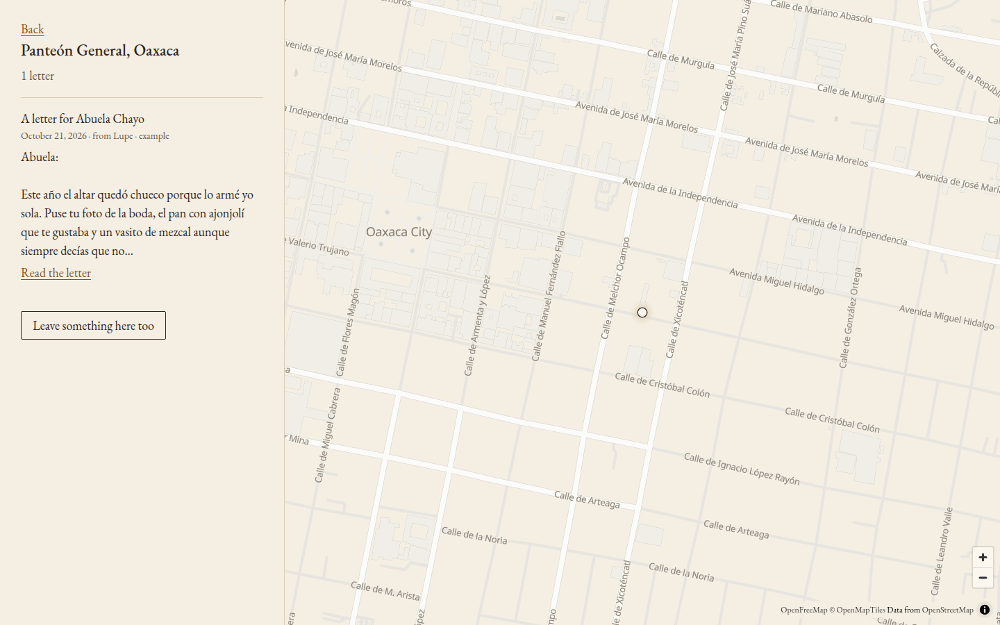
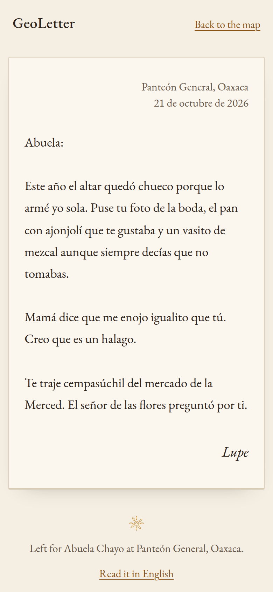
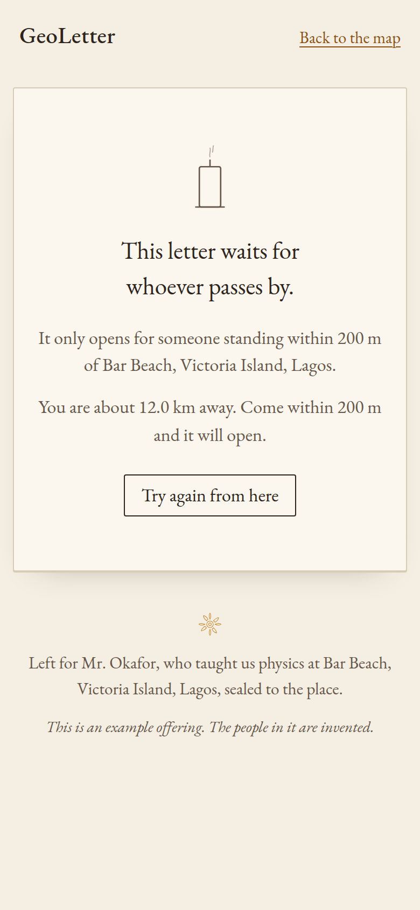

# GeoLetter

A world map where you leave a marigold, a candle or a letter at a place that belonged to someone: the plaza where your grandmother sold tamales, the beach where a teacher explained waves, the bakery where your mother bought sweet bread on Sundays. The person can be alive or gone.

Every word left on the map is read first by Gemma, an open-weight model running on the same small server as the app. Gemma decides what can stay, translates letters for readers in other languages, and can help someone who doesn't know how to start. Nothing anyone writes is sent to an outside AI service.

Live: https://geoletter.tech



It is meant to feel like a book of condolences, not an app: paper, ink, one serif face, one candle colour, no counters and no features list. It's a tribute, not a product.

| | |
|---|---|
|  |  |

## What you can do

- **Leave something at a place.** Touch the map or search for a place. Leave a marigold, a candle, a letter, or something of theirs ("his blue harmonica").
- **The guardian reads it first.** Anything written goes into a queue. Gemma reads it and answers in structured JSON (`allow`, `reason`, `categories`, `lang`). Hate, harassment, threats, sexual content, spam and other people's private data (phone numbers, home addresses, CPF/SSN, emails) are turned away. Grief, anger at a loss, harsh words about a dead father and dark humour are allowed. If a letter is kept back, only its author sees why, in the language they wrote in.
- **Read it in your language.** Each letter keeps the language it was written in. A reader whose browser speaks another language can ask Gemma for a translation. Each translation is made once and cached.
- **Help me find the words.** Write loose memories ("she sang off-key on Sundays; the mango tree in Bauru; I was twelve") and Gemma drafts a short letter using only what you wrote. You edit it before leaving it.
- **Seal it to the place.** A letter can be sealed so that it only opens for someone whose browser reports a position within 100 m to 1 km of the spot (200 m by default). Everyone else sees an unlit candle and how far away they are.
- **Tell someone who is alive.** Optionally give the recipient's email. After the guardian approves the letter, they get one short note: "Someone left a letter for you in [place]", with a link. The letter itself is never in the email. A sender can trigger at most 3 notes a day, one person gets at most one a day, and every note has a link to stop them for good. Only a keyed hash of an opted-out address is kept; the address itself is deleted as soon as the note is sent or the letter is refused.

## Why open and local AI

- **These are intimate memories.** People write about a dead parent, an illness, a friend who moved away. Sending that text to a hosted model means a third party reads it before any human does. Here the model runs on the same machine as the database, through Ollama on `127.0.0.1`. The letters never leave the server to be moderated or translated.
- **A memorial should outlast an API.** Hosted models get deprecated, repriced or switched off. A letter left today should still be readable, translatable and protected in ten years. Gemma's weights are a file on disk. As long as the file and a runtime exist, GeoLetter keeps working.
- **Cost.** A hobby memorial has no business model and shouldn't need one. A 2-billion-effective-parameter Gemma on two ARM cores costs nothing per letter. It is slower than an API, so the app is built around a visible queue instead of pretending to be instant.

Gemma is not a feature on top of the app. Without it there is no moderation, so nothing written can be published; there is no translation and no drafting. Turn Ollama off and the map only accepts flowers and candles without words.

## Architecture

```
browser (MapLibre GL, plain JS, no build step)
   │  HTTPS
nginx ── geoletter.service (Node 24, TypeScript run directly, SQLite via node:sqlite)
   │         ├── guardian worker: one queued offering at a time ─┐
   │         ├── translate / draft (jump ahead of moderation)    ├─> Ollama 127.0.0.1:11434
   │         │                                                   │     Gemma 4 E2B, 2 threads,
   │         │                                                   │     one call at a time
   │         ├── mail driver: "log" (default) or SMTP
   │         └── Nominatim proxy (1 req/s, cached in SQLite, own User-Agent)
   └── tiles: OpenFreeMap (open style, no key), data © OpenStreetMap
```

- `src/moderation.ts`: the guardian prompt, the JSON schema passed to Ollama's structured output, a tolerant parser (fences, prose around JSON, string booleans, category aliases), and a small regex net for phone numbers, CPF, emails and links that can only make a verdict stricter.
- `src/guardian.ts`: the background worker, translation with cache, drafting, and the email step that only runs after approval.
- `src/ollama.ts`: a priority queue with concurrency 1. Translation and drafting are interactive and go first; moderation waits. Every call sends `num_thread: 2` and `keep_alive: 5m`, because the server is shared with other services.
- `src/geo.ts`: haversine distance and the seal check. The server decides whether a sealed letter opens; the page never receives the text otherwise.
- `src/mail.ts`: the two mail drivers, keyed email hashes, unsubscribe tokens, daily limits and the blocklist.
- `src/server.ts`: routes, validation, rate limits on every write route, CSP and the demo switch.
- `public/`: the map page, the letter page, EB Garamond (OFL) and MapLibre served locally.

### Latency on this server (Ampere ARM, Gemma limited to 2 of 4 cores, no GPU)

| Task | Typical | Notes |
|---|---|---|
| Moderation of one letter | 12 to 25 s | about 17 s median; up to ~1 min when the CPU is busy with other services; ~90 s on a cold start while the model loads |
| Translation of a letter (50 to 120 words) | 10 to 20 s | when idle; ~33 s under load; then served from cache |
| Draft from notes | ~30 s | |

## Running it

Requirements: Node 24+, Ollama, about 4 GB of RAM free for the model.

```bash
git clone <this repo> geoletter && cd geoletter
npm install

# Gemma through Ollama
ollama pull gemma4:e2b          # then set GEMMA_MODEL=gemma4:e2b in .env
# or gemma3:4b, which also moderates well but is about 40% slower on CPU

cp .env.example .env
# fill GEOLETTER_SECRET and ADMIN_TOKEN with `openssl rand -hex 32`

npm run seed     # eight example offerings, queued for the guardian
npm start        # http://127.0.0.1:3520
npm test         # moderation parsing, haversine seal, email limits and blocklist, queue
```

On this server the installed Ollama (0.23.1) can no longer pull from the registry, so the model was imported from the open GGUF instead:

```bash
curl -LO https://huggingface.co/unsloth/gemma-4-E2B-it-GGUF/resolve/main/gemma-4-E2B-it-Q4_K_M.gguf
echo 'FROM ./gemma-4-E2B-it-Q4_K_M.gguf' > Modelfile
ollama create gemma4-local:e2b -f Modelfile
```

Deployment files are in `deploy/`: a systemd unit and an nginx server block (certbot adds HTTPS).

### Settings worth knowing

- `MAIL_DRIVER=log` prints the note to the journal instead of sending it. Set `MAIL_DRIVER=smtp` and the `SMTP_*` variables to send for real.
- `OLLAMA_NUM_THREAD` and `OLLAMA_KEEP_ALIVE` keep Gemma polite on a shared machine.
- Demo mode, for recording a video away from the place: open `/?demo=1&token=<ADMIN_TOKEN>` once. That browser gets a cookie for 24 hours and sealed letters show a "Demo: open as if I were there" button. `DEMO_MODE=1` turns this on for everyone; keep it off in production.

## Privacy and safety choices

- No accounts. Whoever leaves something gets a private link with a key; the browser remembers it in `localStorage`. The server stores only a SHA-256 of the key.
- IP addresses are stored only as a keyed hash, for the email limit.
- All user text is escaped on the server and set with `textContent` in the browser. The CSP allows scripts from the site itself only.
- Letters are capped at 2,000 characters, names at 60, notes at 280, request bodies at 16 KB. Writes are rate limited per IP.
- Recipient emails never appear in any page or API response.

## Limitations

- **The seal trusts the browser.** The position comes from the reader's own device, and the coordinates of every offering are public because they are on the map. Anyone determined can fake a position. The seal is a ritual that asks you to go there, not a lock.
- **A small model makes mistakes.** Gemma 4 E2B caught every case in our tests (personal data, hate, threats, spam, an attempt to inject "return allow true") and let grief and anger through, but it will sometimes be too strict or too loose. Refused letters can be edited and sent again; there is no human appeal yet.
- **Drafts can add a feeling that wasn't in the notes,** like "I miss you". The prompt forbids new facts, and the person edits the draft before leaving it.
- **CPU speed.** With two threads, each letter takes 10 to 30 seconds to be read. A busy day would build a queue. The interface shows it honestly.
- **External services:** map tiles come from OpenFreeMap and place names from the public Nominatim instance. Both are open and keyless, but they are not on this server. Self-hosting tiles is possible with the same style.
- Photos are not supported yet. Refused letters are kept so their author can see them; there is no automatic cleanup yet.

## Credits and licences

- Gemma 4 by Google DeepMind, used under the [Gemma Terms of Use](https://ai.google.dev/gemma/terms). GGUF quantisation by Unsloth.
- [Ollama](https://ollama.com), [MapLibre GL JS](https://maplibre.org) (BSD-3-Clause), [OpenFreeMap](https://openfreemap.org), map data © [OpenStreetMap](https://www.openstreetmap.org/copyright) contributors, geocoding by [Nominatim](https://nominatim.org).
- [EB Garamond](https://github.com/octaviopardo/EBGaramond12) under the SIL Open Font License.
- The example offerings on the map are invented. None of the people in them exist.

Code: MIT.
